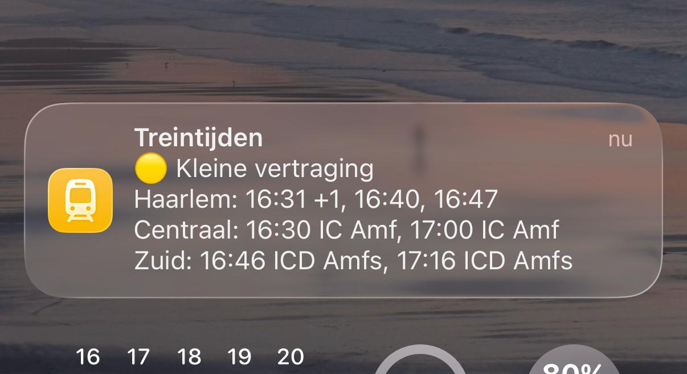

# Treintijden

I commute by train from Amersfoort to Amsterdam and Haarlem. This small Express server reads the NS departure boards and turns them into two things I look at every day:

- a list of departures for my [TRMNL](https://usetrmnl.com) e-ink display, and
- one notification on my iPhone, from an Apple Shortcut, that tells me whether my trains are on time.



The notification above is the afternoon version. The first line gives the worst delay among the trains below it. 🟢 is on time, 🟡 is 1 to 4 minutes late, and 🔴 means 5 minutes or more, or a cancelled train. Then come three lines, one per place I might board on the way home.

- `Haarlem` lists the next three trains to Amsterdam. `16:31 +1` leaves a minute late.
- `Centraal` lists the next two intercitys from Amsterdam Centraal that stop at or end in Amersfoort Centraal.
- `Zuid` does the same for Amsterdam Zuid. `ICD Amfs` is an Intercity Direct to Amersfoort Schothorst. Destinations use the NS station codes so a line fits on a lock screen.

A cancelled train shows as `16:30 ✕ IC Amf`.

## The two endpoints

Both read the NS [Reisinformatie API](https://apiportal.ns.nl/) (`/reisinformatie-api/api/v2/departures`).

### `GET /api/train-times` for the TRMNL

Returns the departure board of one station as plain JSON, which a TRMNL private plugin polls and lays out on the e-ink screen:

```json
{
  "trains": [
    {
      "planned_time": "08:12",
      "direction": "Amsterdam Centraal",
      "delay_minutes": 0,
      "cancelled": false,
      "track": "5",
      "train_type": "IC"
    }
  ],
  "updated_at": "2026-10-10T06:05:00.000Z",
  "station": "AMF"
}
```

Two settings trim the board. `DELAY` hides trains you can no longer catch: with `DELAY=10` it drops everything leaving in the next 10 minutes. `DESTINATION_FILTER` hides destinations you never travel to.

### `GET /api/first-intercity` for the Shortcut

The Shortcut fetches this URL and shows the `message` field as a notification. The answer depends on the time of day.

**Before 13:00** it looks at Amersfoort and lists the next two intercitys via Hilversum to Amsterdam Centraal, and the next two to Amsterdam Zuid. Something like:

```
🟢 Op tijd
Centraal: 08:03 IC Asd, 08:33 IC Asd
Zuid: 08:16 ICD Asdz (Amfs: +7), 08:46 ICD Asdz
```

The `(Amfs: +7)` note is the one thing NS does not tell you. Every intercity to Amsterdam Zuid first runs out to Amersfoort Schothorst and turns around there. If that train is 5 or more minutes late on its way out, my train to Zuid will probably leave late as well, even while NS still shows it as on time. If NS cancels the Schothorst leg the note stays away. NS then turns the train early at Amersfoort Centraal, and whatever delay is left shows on the Zuid train itself.

**From 13:00** it switches to the trip home: three departure boards (Haarlem, Amsterdam Centraal, Amsterdam Zuid) in one message, as in the screenshot.

`?station=` and `?via=` override the defaults (`AMF` and `Hilversum`).

## The Shortcut

The Shortcut needs three actions:

1. **Get Contents of URL**: `https://<your-deploy>/api/first-intercity?token=<ACCESS_TOKEN>`
2. **Get Dictionary Value**: `message`
3. **Show Notification** with that value.

Run it from the home screen, or from a Personal Automation at the times you usually leave.

## Running it

Needs Node 18 or newer.

```sh
npm install
NS_API_KEY=... npm start   # listens on $PORT, default 3000
npm test
```

It runs on [Railway](https://railway.com) with `railway.json`. Settings:

| Variable | What it does |
|---|---|
| `NS_API_KEY` | Subscription key for the NS API portal. Required. |
| `ACCESS_TOKEN` | Shared secret for everything under `/api`. Send it as `Authorization: Bearer ...`, an `X-Access-Token` header or `?token=`. Without it the API is open to anyone. |
| `STATION` | Station code for `/api/train-times` and the morning message. Default `AMF`. |
| `DELAY` | Hide departures in the next N minutes on `/api/train-times`. |
| `DESTINATION_FILTER` | Comma-separated destinations to hide on `/api/train-times`. |

On start-up the server runs its own test suite. If a test fails, the Shortcut message gets an extra line such as `1 test failed`, so a broken deploy shows up on my phone instead of in a log I never read.
